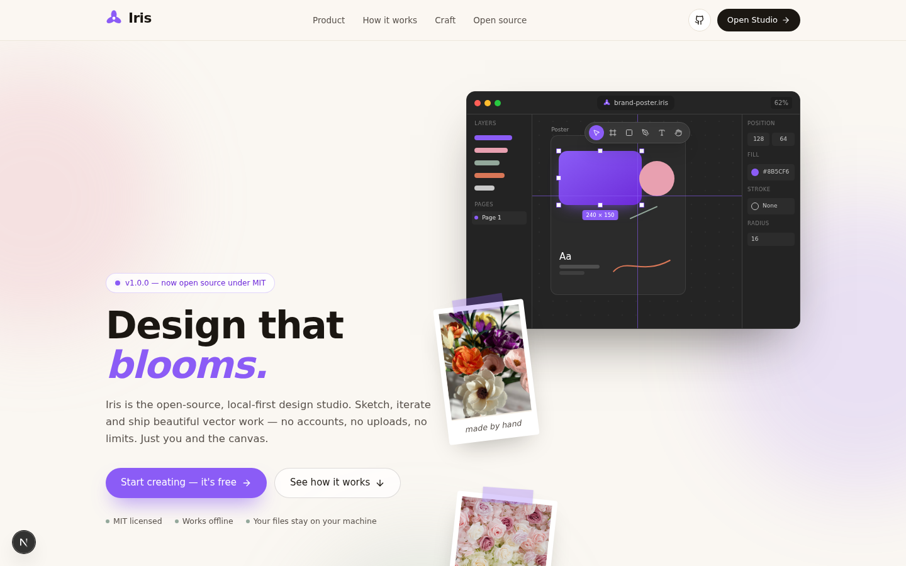
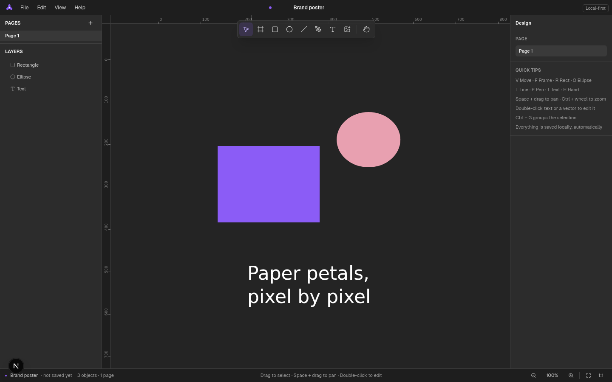
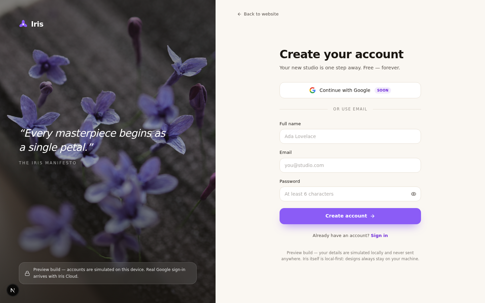

<div align="center">


# Iris

**The open-source, local-first design studio.**

Iris is a free, Figma-style vector design tool that runs entirely in your
browser. No accounts. No uploads. No tracking. Your designs live on your
machine — where they belong.

[Website](#) · [Features](#-features) · [Getting started](#-getting-started) · [Roadmap](#-roadmap) · [Contributing](#-contributing)

[](./LICENSE)
[](https://nextjs.org)
[](https://www.typescriptlang.org)
[](./CONTRIBUTING.md)



</div>

---

## Why Iris?

Most design tools want your files in *their* cloud. Iris takes the opposite
bet: **a studio-grade editor with zero servers**. It is a clean-room
reimplementation of the Figma editing experience — tools, panels, shortcuts
and behaviors — written from scratch, tuned for the browser, and released
under MIT.

| | Iris v1 |
|---|---|
| **Your files** | Stay in your browser / on your disk — never uploaded |
| **Accounts** | None required (a preview account flow exists; see below) |
| **Offline** | Fully functional — it is a local app that happens to ship in a tab |
| **Price** | Free forever, MIT-licensed |

## Screenshots

| The studio | The account flow (preview) |
|---|---|
|  |  |

## ✨ Features

### Canvas
- Infinite pan (Space + drag, middle-drag, Hand tool `H`) and zoom-to-cursor (`Ctrl` + wheel)
- Zoom controls, zoom to fit (`Shift+1`), zoom to selection (`Shift+2`), reset 100% (`Ctrl+0`)
- Rulers, pixel grid at high zoom, frame name labels

### Tools *(Figma shortcuts)*
- Move `V` · Frame `F` · Rectangle `R` · Ellipse `O` · Line `L` · Pen `P` · Text `T` · Hand `H`
- Image import via toolbar, drag-and-drop, or paste

### Objects
- Frames (with clipping + children), groups (`Ctrl+G` / `Ctrl+Shift+G`)
- Rects with corner radius, ellipses, lines, bezier paths, text, images
- In-canvas text editing overlay; pen tool with click = corner, drag = mirrored
  smooth handles; double-click a vector to edit points and handles

### Selection & transform
- Click, Shift multi-select, marquee, Ctrl-click deep select, double-click into groups/frames
- 8 resize handles + rotation handle, Shift-constrain, Alt-center resize, Alt-drag duplicate
- Arrow-key nudge (`Shift` = 10 px), smart snap guides to sibling edges/centers

### Panels
- **Layers** — pages, tree with type icons, visibility/lock toggles, inline rename, drag reorder
- **Properties** — X/Y/W/H/rotation/radius, opacity, fill, stroke, full text controls,
  6 alignments + 2 distributes

### Documents
- Undo/redo with snapshot history and coalescing (`Ctrl+Z` / `Ctrl+Shift+Z`)
- `.iris` JSON documents (New / Open / Save / Save As), debounced localStorage autosave, recent documents
- Export to PNG (1×/2×) and SVG — selection, frame or page

## ⌨️ Keyboard shortcuts

| Context | Shortcut | Action |
|---|---|---|
| Tools | `V` `F` `R` `O` `L` `P` `T` `H` | Move · Frame · Rect · Ellipse · Line · Pen · Text · Hand |
| View | `Ctrl` + wheel | Zoom to cursor |
| View | `Shift+1` / `Shift+2` / `Ctrl+0` | Zoom to fit / selection / 100% |
| View | `Space` + drag | Pan |
| Edit | `Ctrl+Z` / `Ctrl+Shift+Z` | Undo / redo |
| Edit | `Ctrl+G` / `Ctrl+Shift+G` | Group / ungroup |
| Edit | `Ctrl+D` | Duplicate |
| Edit | `Alt` + drag | Duplicate & drag |
| Edit | Arrows (+`Shift`) | Nudge 1 px (10 px) |
| Files | `Ctrl+S` / `Ctrl+O` | Save / open `.iris` |
| Home | `/` | Focus file search |

Press `?` inside the studio for the full in-app shortcut overlay.

## 📄 `.iris` document format

Every Iris file is a single self-describing JSON document:

```jsonc
{
  "format": "iris",
  "version": 1,
  "name": "Brand poster",
  "pages": [{ "id": "…", "name": "Page 1", "children": ["…"] }],
  "nodes":   { "…": { "type": "rect", "x": 128, "y": 64, "w": 240, "h": 150, "fill": "#8B5CF6" } },
  "images":  { "…": "data:image/png;base64,…" }
}
```

- **Stable schema, versioned** — forward-compatible migrations on load.
- **Human-readable** — diffs cleanly in git, trivially scriptable.
- **Round-trips exactly** — File → Save downloads the file; File → Open restores
  it bit-for-bit.

## 🔒 Privacy

Iris collects nothing. There are no analytics, no telemetry, no error
reporting, no cookies. Documents autosave to your browser's `localStorage`
and to `.iris` files you choose to save. In this preview the account flow is
simulated on-device (see below) — nothing is ever transmitted.

## 🏗️ Architecture

```
src/
  app/                     # Next.js 16 App Router shell (single "/" route)
    page.tsx               #   → dynamic import of the client gate (ssr: false)
    layout.tsx             #   fonts (Geist + Fraunces) + metadata
  iris/
    engine/                # framework-agnostic core (zero React imports)
      model.ts             # Document -> Pages -> Nodes (Frame, Group, Rect,
                           #   Ellipse, Line, Path, Text, Image); flat map + tree
      geometry.ts          # mat2d transforms, bounds, hit-testing, snapping,
                           #   selection-handle geometry, text metrics
      store.ts             # zustand store: doc, selection, tool, viewport,
                           #   snapshot history, clipboard, align/group/z-order
      renderer.ts          # canvas draw pass, selection overlay, snap guides,
                           #   rulers, pixel grid, draw previews
      tools.ts             # pointer/keyboard state machine
                           #   (marquee/move/resize/rotate/draw/pan/pen/text)
      overlay.ts           # mutable interaction state shared by tools -> renderer
      export.ts            # PNG (offscreen canvas) + SVG serialization
      files.ts             # .iris file I/O, recents, image import (IPC shim)
      library.ts           # local document library + thumbnails
      router.ts            # client-side routing: / <-> /?doc=<id>
    ui/                    # React shell
      AppGate.tsx          # phase flow: landing → account → studio
      HomeBrowser.tsx      # file browser (search, sort, grid/list, recents)
      TitleBar.tsx         # menus, document name, Local-first badge
      CanvasView.tsx       # canvas element + pointer wiring
      Toolbar.tsx          # floating tool switcher
      LayersPanel.tsx      # pages + layers tree
      PropertiesPanel.tsx  # design properties (position/fill/stroke/text)
      StatusBar.tsx        # doc state, hints, zoom
      ContextMenu.tsx      # right-click actions
      ExportDialog.tsx     # PNG/SVG export options
      ShortcutsOverlay.tsx # "?" cheat-sheet
    marketing/             # the website (landing page)
      LandingPage.tsx      # hero, how-it-works, features, craft gallery, CTA
      brand.ts             # palette, imagery, links
    auth/
      session.ts           # PREVIEW account simulation (localStorage)
      AuthPage.tsx         # sign-up / sign-in screen (preview)
```

The engine can be dropped into any host — the file layer (`files.ts`) is the
seam where Electron IPC (`window.irisAPI` via `contextBridge`) replaces the
browser download/upload shim in the planned desktop build.

## 🚀 Getting started

```bash
git clone https://github.com/thebluedogcorp/iris.git
cd iris
bun install          # or: npm install
bun run dev          # http://localhost:3000
```

Other handy scripts:

```bash
bun run lint         # ESLint (Next.js core-web-vitals + TS rules)
bun run db:generate  # regenerate the Prisma client (schema is minimal today)
```

> **Node/Bun**: developed and tested with Bun 1.2+ and Node 20+.

## 🗺️ Roadmap

- ✅ **v1.0 — the local studio** (this release): full editor, `.iris` files,
  home browser, marketing site
- 🔜 **v1.1** — multi-fill/stroke, gradients, effects; boolean operations;
  components & instances; auto layout & constraints
- 🔜 **v1.2** — prototyping; plugin API; Electron desktop packaging
  (`src/main` + `src/preload`)
- 🌤️ **Iris Cloud (optional)** — Google sign-in via NextAuth.js (the preview
  account flow already mirrors the final UX), encrypted sync & backup,
  link sharing, real-time collaboration. Always opt-in: the local studio
  stays fully functional without it.

## 🤝 Contributing

Iris is built in the open and contributions are welcome — bug reports,
feature ideas, keyboard-shortcut nits and pull requests alike.

1. Fork & branch: `feat/my-feature` or `fix/my-bugfix`
2. `bun run lint` must pass
3. Keep the engine framework-agnostic (no React imports in `src/iris/engine`)
4. Open a PR with a clear description + screenshots for UI changes

See [GOOD_FIRST_ISSUES](https://github.com/thebluedogcorp/iris/issues?q=is%3Aissue+is%3Aopen+label%3A%22good+first+issue%22)
to get started.

## 📜 License

[MIT](./LICENSE) — Iris is an independent project and is not affiliated with
Figma, Inc.

## 🌸 Acknowledgments

- The paper-flower photography on the website comes from independent craft
  studios around the web — used with appreciation, made with crepe paper.
- Built by [The Blue Dog](https://github.com/thebluedogcorp) — *crafted with
  paper petals & pixels.*
